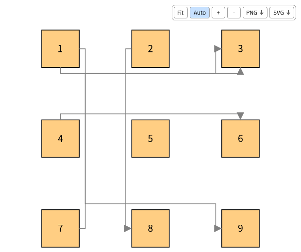
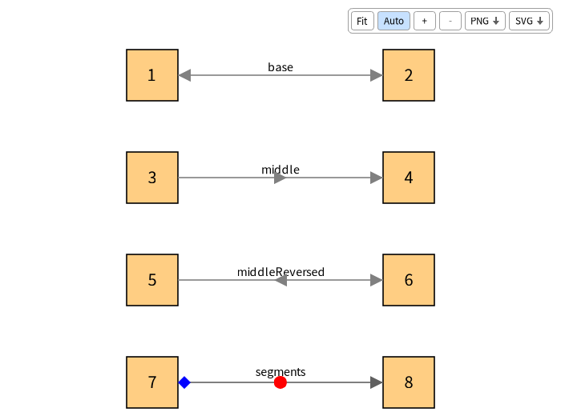
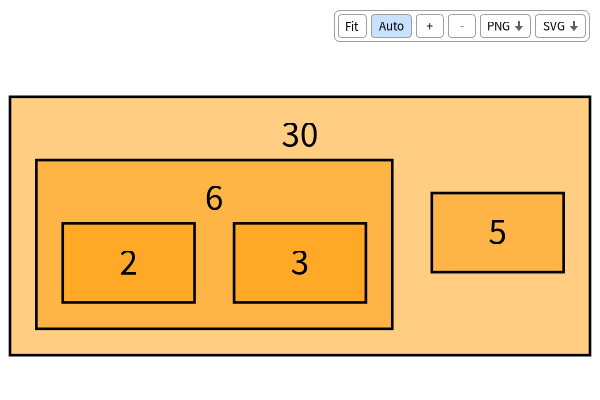
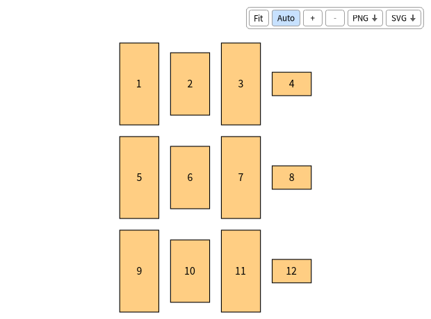
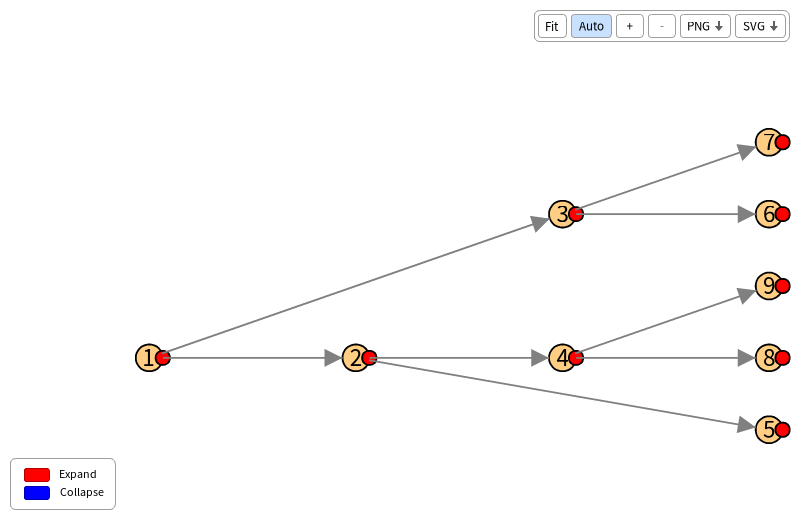

# TelescopeBloc

[Telescope](https://github.com/TelescopeSt/Telescope) is an engine to create visualizations: the user describes nodes, connections, layouts, styles and interactions, and a connector renders them with a graphical framework.
TelescopeBloc is the connector which renders them with [Bloc](https://github.com/pharo-graphics/Bloc), the graphical framework of Pharo, in a Bloc window.


## Install

```Smalltalk
Metacello new
	githubUser: 'TelescopeSt' project: 'TelescopeBloc' commitish: 'development' path: 'src';
	baseline: 'TelescopeBloc';
	load
```

To depend on it from a baseline:

```Smalltalk
spec baseline: 'TelescopeBloc' with: [ spec repository: 'github://TelescopeSt/TelescopeBloc:development/src' ]
```

The baseline loads the dev branch of Bloc and the core of Telescope v2.x.x.
The demos of Telescope are loaded too, for the demo browser.
The groups are `core` (the connector), `demo` (the demo browser), `tests` and `default` (all of them).

## Use

A visualization of Telescope is rendered by the connector with the highest priority of the image, so once TelescopeBloc is loaded:

```Smalltalk
visualization := TLVisualization new.
visualization styleSheet nodeLabel: #asString.
visualization addNodesFromEntities: (1 to: 10).
visualization open
```

To choose the connector, or to open the window without a display (for tests):

```Smalltalk
connector := TLBlocConnector new.
connector host: BlHeadlessHost default.
visualization generator: connector.
visualization open
```

The demos of Telescope are in `TLDemos`: for example `TLDemos exampleSimpleConnections open`.
The demo browser lists them, filters them, shows the visualization and the source of the demo: in the world menu, `Telescope > Telescope bloc demo browser`, or `TLBlocDemoPresenter open`.

## What the window offers

- The mouse wheel zooms around the mouse, and a press on the background pans.
- A press on a node and a move drag the node, and the connections follow. A layout which is applied again puts it back.
- The toolbar at the top fits the visualization into the window, zooms, exports it as a PNG or as a SVG (a file chooser opens), and turns the auto fit on or off. Each button has a tooltip after one second.
- The legend of the visualization is at the bottom left.
- A visualization is fitted into its window when it opens, and again when a layout applied again moves or adds nodes, unless the auto fit is off.
- The nodes move smoothly when a layout is applied again, and the ones an interaction adds slide from the node of the interaction.

## What is rendered

- Nodes: the shapes of Telescope, colors (also from the entity, with a block or a gradient), borders (solid, dashed, dotted, double), sizes from the entity, labels (positions, wrapping, ellipsis, text color), `takeAllSpace`, composite nodes with their children and a header for an inside label.
- Groups and every layout of Telescope.
- Connections: Bezier curves (arcs for parallel connections), direct lines, segments with right angles which go around the other nodes, loops for a node connected to itself, line styles, head shapes, arrows at the start and at the middle (substyles `base`, `middle` and `middleReversed`), and labels next to the line.
- Interactions: mouse over, click, double click, right click, drop, moved, menus, pop ups, shape triggers (`triggerPosition`) and external triggers (`connector triggerExternal: interactionOrId`).
- Legends: static and dynamic entries.

### Gallery

Segments which go around the nodes (`TLSegmentsCurve`):



Arrows at the start (`base`), at the middle (`middle`, `middleReversed`) and at the end (the head) of a connection:



Composite nodes, with the label inside of them in a header above their children:



Nodes which take all the space of their line (`takeAllSpace`):



Shape triggers, here the ones of the tree explorer which expand a node when they are clicked:



## Not implemented

- `showChildrenConnectionsOnParent`, which Telescope itself leaves as a stub.
- `generatePopupInteraction:` and `generateBasicInteraction:onNode:` of the connector, which nothing calls.

## Tests

The tests are in `Telescope-Bloc-Tests` and use the headless host of Bloc, so they need no display:

```Smalltalk
(TestSuite named: 'TelescopeBloc') in: [ :suite |
	(PackageOrganizer default packageNamed: 'Telescope-Bloc-Tests') definedClasses
		select: [ :class | class inheritsFrom: TestCase ]
		thenDo: [ :class | class suite tests do: [ :test | suite addTest: test ] ].
	suite run ]
```

The continuous integration runs them with smalltalkCI on Pharo 14 and Pharo 15 (`.smalltalk.ston`).

## License

MIT, see [LICENSE](LICENSE).
