# TelescopeBloc

[Telescope](https://github.com/TelescopeSt/Telescope) is an engine to create visualizations: the user describes nodes, connections, layouts, styles and interactions, and a connector renders them with a graphical framework.
TelescopeBloc is the connector which renders them with [Bloc](https://github.com/pharo-graphics/Bloc), the graphical framework of Pharo, in a Bloc window.
The API of Telescope, which is the same for every connector, is described in the [Telescope documentation](https://github.com/TelescopeSt/Telescope/tree/development/resources/doc/README.md), with the same pictures and GIFs as below.

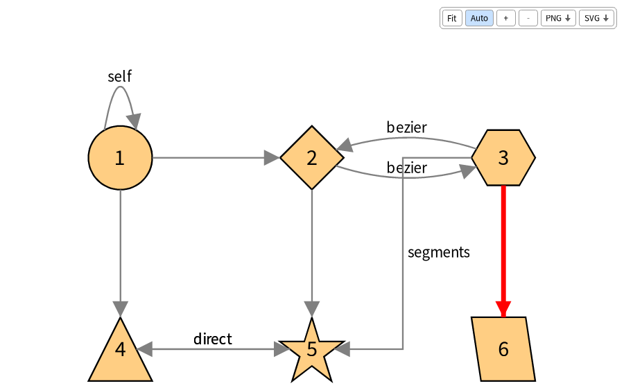

## Install

```Smalltalk
Metacello new
	githubUser: 'TelescopeSt' project: 'TelescopeBloc' commitish: 'development' path: 'src';
	baseline: 'TelescopeBloc';
	load
```

To depend on it from a baseline:

```Smalltalk
spec baseline: 'TelescopeBloc' with: [ spec repository: 'github://TelescopeSt/TelescopeBloc:development/src' ]
```

The baseline loads the stable Bloc (the releases tagged v3.x.x) and the core of Telescope v2.x.x.
The demos of Telescope are loaded too, for the demo browser.
The groups are `core` (the connector), `demo` (the demo browser), `tests` and `default` (all of them).

## Use

A visualization of Telescope is rendered by the connector with the highest priority of the image, so once TelescopeBloc is loaded:

```Smalltalk
visualization := TLVisualization new.
visualization styleSheet nodeLabel: #asString.
visualization addNodesFromEntities: (1 to: 10).
visualization open
```

To choose the connector, or to open the window without a display (for tests):

```Smalltalk
connector := TLBlocConnector new.
connector host: BlHeadlessHost default.
visualization generator: connector.
visualization open
```

The demos of Telescope are in `TLDemos`: for example `TLDemos exampleSimpleConnections open`.
The demo browser lists them, filters them, shows the visualization and the source of the demo: in the world menu, `Telescope > Telescope bloc demo browser`, or `TLBlocDemoPresenter open`. The pictures below come from them and from the examples of the [documentation](https://github.com/TelescopeSt/Telescope/tree/development/resources/doc/README.md): the demos to open in the browser are named after each picture.

## What the window offers

- The mouse wheel zooms around the mouse, and a press on the background pans.
- A press on a node and a move drag the node, and the connections follow. A layout which is applied again puts it back.
- The toolbar at the top fits the visualization into the window, zooms, exports it as a PNG or as a SVG (a file chooser opens), and turns the auto fit on or off. Each button has a tooltip after one second.
- The legend of the visualization is at the bottom left.
- A visualization is fitted into its window when it opens, and again when a layout applied again moves or adds nodes, unless the auto fit is off.
- The nodes move smoothly when a layout is applied again, and the ones an interaction adds slide from the node of the interaction.

## What is rendered

- Nodes: the shapes of Telescope, colors (also from the entity, with a block or a gradient), borders (solid, dashed, dotted, double), sizes from the entity, labels (positions, wrapping, ellipsis, text color), `takeAllSpace`, composite nodes with their children and a header for an inside label.
- Groups and every layout of Telescope.
- Connections: Bezier curves (arcs for parallel connections), direct lines, segments with right angles which go around the other nodes, loops for a node connected to itself, line styles, head shapes, arrows at the start and at the middle (substyles `base`, `middle` and `middleReversed`), and labels next to the line.
- Interactions: mouse over, click, double click, right click, drop, moved, menus, pop ups, shape triggers (`triggerPosition`) and external triggers (`connector triggerExternal: interactionOrId`).
- Legends: static and dynamic entries.

## In pictures

Everything below is what the connector renders from the API of Telescope. Each chapter of the [Telescope documentation](https://github.com/TelescopeSt/Telescope/tree/development/resources/doc/README.md) has the code of these examples and all the options.

### Moving around and animations

The window is fitted to the visualization when it opens. The mouse wheel zooms around the mouse, a press on the background pans, and the toolbar fits, zooms, turns the auto fit off and exports the visualization as a PNG or a SVG. A press on a node drags it, and the connections follow it (the demo *Simple connections*):

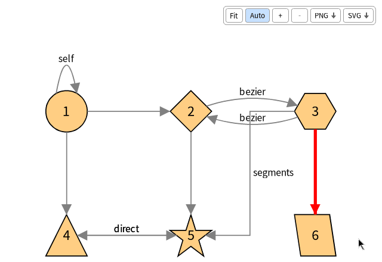


When a layout is applied again the nodes slide to their new places, here when the layout of a group is replaced by a click (the demo *Changing layout*):

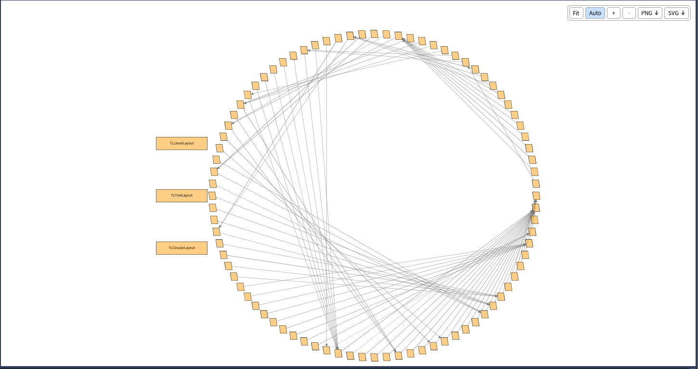

### Interactions

Every interaction of Telescope is supported: mouse over, click, double click, right click, menus, pop ups, drag and drop, node moved, shape triggers and external triggers. See the chapter on [interactions](https://github.com/TelescopeSt/Telescope/tree/development/resources/doc/07-Interactions.md).

| | |
|---|---|
| Highlighting the node under the mouse (*Highlight elements*) | Connecting nodes on mouse over (*Connect action*) |
|  |  |
| Pop ups, on mouse over and on click (*Pop up*) | Menus and submenus, on right click (*Custom multi choice action*) |
| 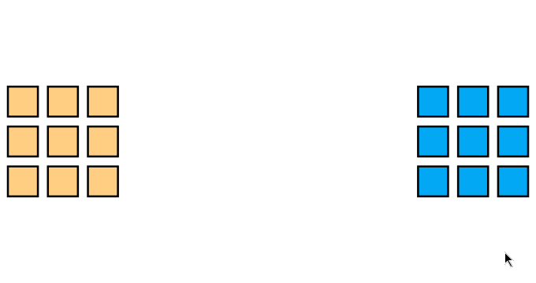 | 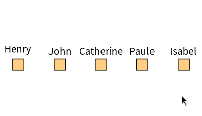 |

Expanding the nodes of a tree with a click, the new nodes sliding from the node (*Expand collapse nodes action*):

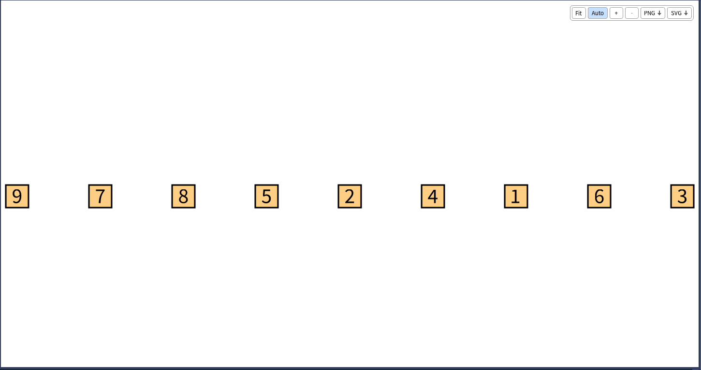

The shape triggers are the small shapes beside a node which run an action, such as the ones of the tree explorer:

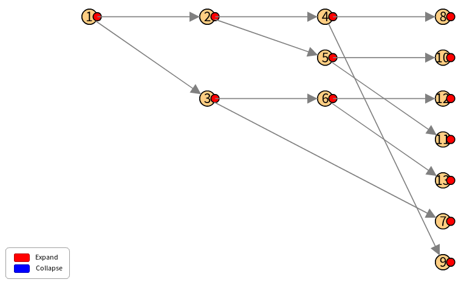

### Composite nodes

Nodes which contain nodes, with the label of a composite node in a header above its children, and the triggers which expand and collapse it (*Recursive composite node*). See the [composite nodes](https://github.com/TelescopeSt/Telescope/tree/development/resources/doc/06-Composite-Nodes.md) chapter.

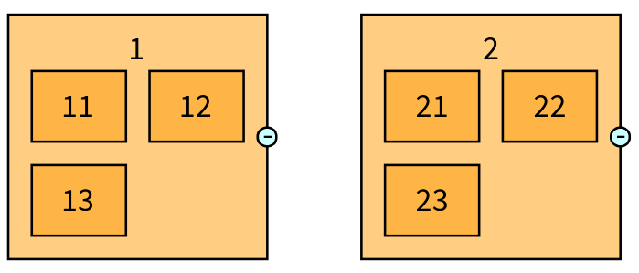


### Nodes, connections and layouts

The shapes of the nodes, which can have all the colors, borders and sizes you want, from their entity (the demo *All shapes*), the layouts, and their direction. See [groups and layouts](https://github.com/TelescopeSt/Telescope/tree/development/resources/doc/03-Groups-and-Layouts.md) and [styling](https://github.com/TelescopeSt/Telescope/tree/development/resources/doc/04-Styling.md).


| | |
|---|---|
| 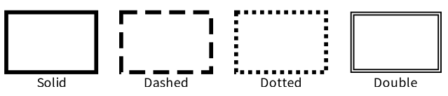 |  |
|  | 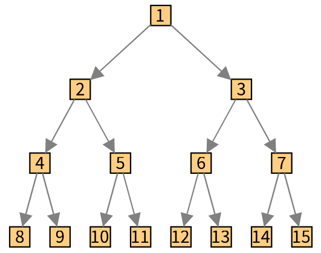 |
|  | 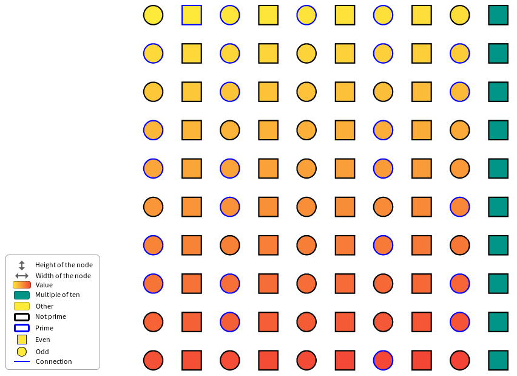 |

The connections, with the curves of Telescope (arcs for the connections which join the same nodes, lines, and segments with right angles which go around the nodes), the line styles, the heads and the arrows (the demos *Simple connections* and *Connection arrows*). See the [connections](https://github.com/TelescopeSt/Telescope/tree/development/resources/doc/05-Connections.md) chapter.

| | |
|---|---|
|  | 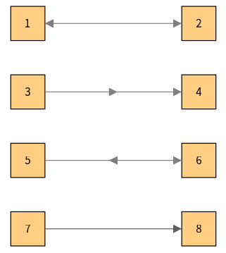 |

### Visualization templates

The ready-made visualizations of Telescope, such as the butterfly, the flow graph and the distribution map (the demos *Butterfly using style functionnality*, *F low control* and *Distribution map*). See [visualization templates](https://github.com/TelescopeSt/Telescope/tree/development/resources/doc/09-Visualization-Templates.md).

| | |
|---|---|
|  |  |


## Not implemented

- `showChildrenConnectionsOnParent`, which Telescope itself leaves as a stub.
- `generatePopupInteraction:` and `generateBasicInteraction:onNode:` of the connector, which nothing calls.

## Tests

The tests are in `Telescope-Bloc-Tests` and use the headless host of Bloc, so they need no display:

```Smalltalk
(TestSuite named: 'TelescopeBloc') in: [ :suite |
	(PackageOrganizer default packageNamed: 'Telescope-Bloc-Tests') definedClasses
		select: [ :class | class inheritsFrom: TestCase ]
		thenDo: [ :class | class suite tests do: [ :test | suite addTest: test ] ].
	suite run ]
```

The continuous integration runs them with smalltalkCI on Pharo 14 and Pharo 15 (`.smalltalk.ston`).

## License

MIT, see [LICENSE](LICENSE).
